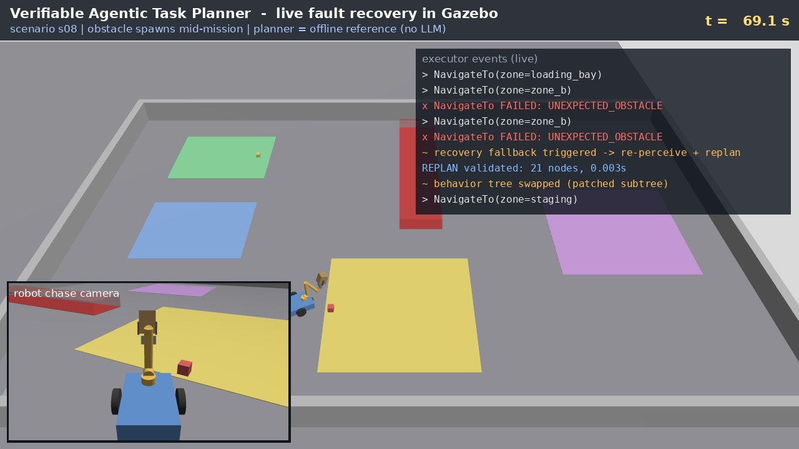
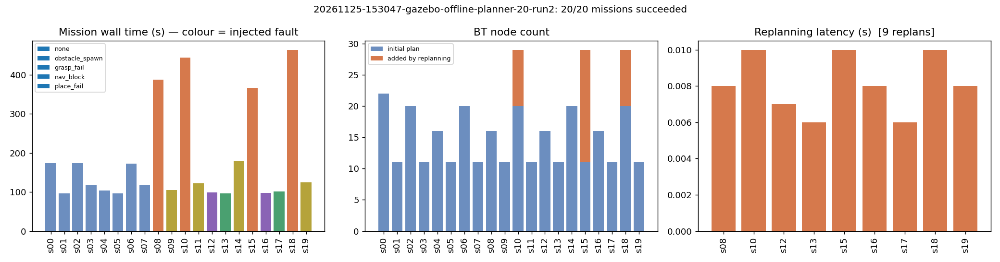

# Verifiable Agentic Task Planner

**LLM → Behavior Tree synthesis with deterministic pre-execution validation and closed-loop recovery**
for a mobile manipulator — ROS 2 Jazzy · Gazebo Harmonic · Nav2 · BehaviorTree.CPP 4 · Groot2/Foxglove.

Raw LLM agents are too unpredictable to drive a robot directly. This project treats the model as a *proposer*:
it emits a plan in a constrained skill vocabulary, a **model-free validator proves safety properties before the
robot moves**, and only then is the plan executed as a BehaviorTree.CPP tree. When execution fails (unexpected
obstacle, failed grasp, blocked path) the supervisor re-perceives the scene and the planner returns a *validated
patch* for the remaining mission.

```
instruction ─► RAG(safety + recovery) ─► LLM (schema-constrained BT) ─► VALIDATOR ─► BT.CPP XML ─► lifecycle executor
                                               ▲                          │ errors                   │ tick
                                               └──── repair prompt ◄──────┘                           ▼
                    validated patch ◄── Replan(failure, re-perceived world) ◄── FAILURE ◄── skill servers (Nav2 · arm · perception)
```

## See it work
A real run in Gazebo Harmonic (scenario s08). An unexpected obstacle appears in the loading bay while the robot is
carrying the crate; navigation fails, the recovery supervisor re-perceives the scene, the planner returns a **validated
patch**, and the robot parks the crate, clears the obstacle, re-fetches the crate and delivers it. All overlays come from
the live executor event stream.

[](docs/media/demo_fault_recovery.mp4)
*Click for the full 60 s recording ([`docs/media/demo_fault_recovery.mp4`](docs/media/demo_fault_recovery.mp4)). Planner in this recording: the offline reference planner (no LLM).*

| the tree, before and after the fault | the benchmark |
|---|---|
|  |  |

Regenerate everything: `scripts/record_demo.sh 8` → `scripts/make_video.py` · `scripts/render_bt.py` · `scripts/render_results.py`.

### Planner backends
The planner is pluggable. `mock` is a deterministic offline reference planner (goal regression with geofence-aware routing);
`anthropic` is an LLM backend that returns schema-constrained JSON. Both feed the same compile → validate → repair loop, so
the validator, executor and recovery logic are identical for either. **Every demo and benchmark in this README uses the
offline reference planner**; the LLM backend is not part of the reported results.

## What is in the box
| capability | where |
|---|---|
| Skill library as single source of truth (prompt, schema, validator **and** C++ executor read the same YAML) | `vatp_core/spec/skills.yaml` |
| **Pre-execution validator**: structure · ports · symbolic execution of every success/failure path (preconditions, keep-out geofence, transit corridors, payload, capacity) · goal verification | `vatp_core/validator.py` |
| Generate → validate → repair loop; replanning for the *remaining* mission | `vatp_core/planner.py` |
| RAG memory (BM25) over safety constraints and recovery procedures | `vatp_core/rag.py`, `knowledge/*.md` |
| LLM backend (schema-constrained output) + deterministic offline reference planner with defect injection | `vatp_core/llm.py`, `mock_planner.py` |
| ROS 2 **lifecycle** BT.CPP executor, recovery supervisor, Groot2 publisher, event stream | `vatp_bt` |
| Lifecycle skill servers (`ExecuteSkill` actions) with pluggable backends: `symbolic` and `gazebo` | `vatp_ros` |
| Gazebo warehouse + mobile manipulator, ros2_control, Nav2, perception, physical grasping, **live fault injection** | `vatp_sim` |
| 20 randomised scenarios × 5 fault types, metrics (success, replans, latency, node count; geofence crossings are counted in the symbolic backend) | `vatp_core/scenarios.py`, `vatp_ros/benchmark.py` |

Architecture details and the honest list of simulation shortcuts: [docs/ARCHITECTURE.md](docs/ARCHITECTURE.md).
Running the demo with Groot2 / Foxglove: [docs/DEMO.md](docs/DEMO.md).

## Quick start (Ubuntu 24.04 + ROS 2 Jazzy)
```bash
sudo bash scripts/install_system_deps.sh      # once: colcon, ros2_control, Foxglove, MoveIt, ...
bash scripts/setup_venv.sh                    # python deps (pytest, pyyaml, LLM client, ...)
source /opt/ros/jazzy/setup.bash && colcon build --symlink-install
source scripts/env.sh

# fast, no Gazebo (CI-friendly)
ros2 launch vatp_ros symbolic.launch.py backend:=mock
ros2 run vatp_ros benchmark --n 20

# full simulation
ros2 launch vatp_sim mission.launch.py backend:=auto scenario:=0 gui:=false dashboard:=true
ros2 run vatp_ros benchmark --n 20 --physical --timeout 900
python scripts/plot_results.py runs/<stamp>/metrics.json
```
`backend:=anthropic` selects the LLM backend (reads `ANTHROPIC_API_KEY`; model and effort via `VATP_MODEL` / `VATP_EFFORT`).
`backend:=mock` is the offline reference planner; `auto` uses it whenever no key is present.

Tests: `colcon test && colcon test-result` · `pytest src/vatp_core/tests` · `pytest src/vatp_sim/test`.

## Fault injection
Each scenario carries one fault, fired when a chosen skill is called for the n-th time:

| fault | effect | expected recovery |
|---|---|---|
| `obstacle_spawn` | a real box model appears in the loading bay (Gazebo) | NAV `UNEXPECTED_OBSTACLE` → replan: clear it, then continue |
| `grasp_fail` | the next *k* grasps miss | `RetryUntilSuccessful` absorbs k<3, replan otherwise |
| `nav_block` | the next 2 navigations fail | retry exhausted → replan |
| `place_fail` | placement fails while holding the object | replan: handle held object, then re-place |

## Results
20 randomised scenarios (4 task templates × 5 fault types), Gazebo Harmonic + Nav2 + physical grasping,
**offline reference planner**.

| | run 1 (before carry fixes) | run 2 (after) |
|---|---|---|
| mission success | 17/20 (85%) | **20/20 (100%)** |
| injected faults recovered | 10/12 | **12/12** |
| scenarios needing replanning | 11 | 9 |
| first-attempt plans passing the validator | 20/20 | 20/20 |
| BT size (initial, median) | 13.5 nodes | 13.5 nodes |



* Run 1 failed only where the small box slipped out of the gripper *while driving* and the backend kept believing it
  was held. Fixes: real finger friction, slower/gentler carrying, drop detection (`OBJECT_LOST` + RAG procedure), and
  re-positioning for stray objects. Run 2 still drops the box occasionally — but now **detects it, replans and recovers**.
* **Keep-out safety.** Every plan that executed was accepted by the validator, which proves that each `NavigateTo` leg clears
  the keep-out aisle with a 0.3 m margin. At run time the aisle is also occupied in Nav2's map and has a physical barrier in the
  world. In the symbolic backend the simulator counts actual crossings: 0 across the 20 scenarios.
* Plan and replan latencies come from the offline planner (~10 ms) and show the pipeline overhead; the validator takes 1–2 ms per plan.
* Full tables: [run 1](docs/results/gazebo_v1_before_carry_fixes/summary.md) ·
  [run 2](docs/results/gazebo_v2_offline_planner_20/summary.md) ·
  [symbolic baseline](docs/results/baseline_offline_planner_symbolic_20.md).

## Limitations (stated up front)
* All reported results use the offline reference planner; the LLM backend is not benchmarked.
* The 20-scenario suite served both to find the run-1 failures and to confirm the run-2 fixes; it is a regression suite, not a held-out evaluation.
* Localisation and perception use simulator ground truth (stand-ins for AMCL and a VLM); the VLM hook is the scene graph given to the planner.
* Grasping uses closed-form IK with a high approach and vertical descent; MoveIt 2 is the planned replacement behind `ArmControl`.
* Validation is sound relative to the symbolic world model — it cannot catch discrepancies between that model and physics (that is what runtime recovery is for).

## License
Apache-2.0
