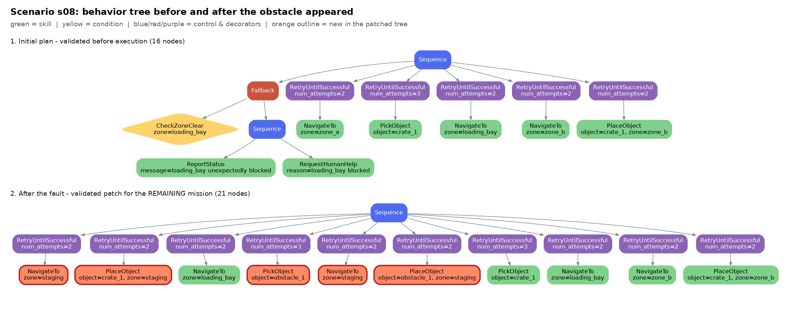
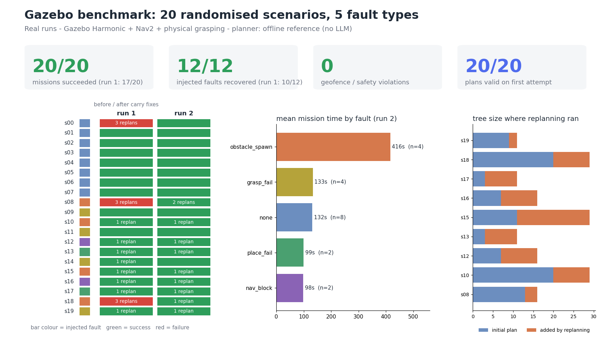

# Verifiable Agentic Task Planner

**LLM → Behavior Tree synthesis with deterministic pre-execution validation and closed-loop recovery**
for a mobile manipulator — ROS 2 Jazzy · Gazebo Harmonic · Nav2 · BehaviorTree.CPP 4 · Groot2/Foxglove.

Raw LLM agents are too unpredictable to drive a robot directly. This project treats the model as a *proposer*:
it emits a plan in a constrained skill vocabulary, a **model-free validator proves safety properties before the
robot moves**, and only then is the plan executed as a BehaviorTree.CPP tree. When execution fails (unexpected
obstacle, failed grasp, blocked path) the supervisor re-perceives the scene and the planner returns a *validated
patch* for the remaining mission.

```
instruction ─► RAG(safety + recovery) ─► LLM (schema-constrained BT) ─► VALIDATOR ─► BT.CPP XML ─► lifecycle executor
                                               ▲                          │ errors                   │ tick
                                               └──── repair prompt ◄──────┘                           ▼
                    validated patch ◄── Replan(failure, re-perceived world) ◄── FAILURE ◄── skill servers (Nav2 · arm · perception)
```

## See it work
A real run in Gazebo Harmonic (scenario s08). An unexpected obstacle appears in the loading bay while the robot is
carrying the crate; navigation fails, the recovery supervisor re-perceives the scene, the planner returns a **validated
patch**, and the robot parks the crate, clears the obstacle, re-fetches the crate and delivers it. All overlays come from
the live executor event stream.

[](docs/media/demo_fault_recovery.mp4)
*Click for the full 60 s recording ([`docs/media/demo_fault_recovery.mp4`](docs/media/demo_fault_recovery.mp4)). Planner in this recording: the offline reference planner (no LLM).*

| the tree, before and after the fault | the benchmark |
|---|---|
|  |  |

Regenerate everything: `scripts/record_demo.sh 8` → `scripts/make_video.py` · `scripts/render_bt.py` · `scripts/render_results.py`.

### Planner backends
The planner is pluggable. `mock` is a deterministic offline reference planner (goal regression with geofence-aware routing);
`gemini` and `anthropic` are LLM backends that return schema-constrained JSON. All of them feed the same compile → validate →
repair loop, so the validator, executor and recovery logic are identical for every backend. The Gazebo demo and the Gazebo
benchmark tables use the offline reference planner; the LLM results have their own section
([LLM planner results](#llm-planner-results), symbolic skill backend).

## What is in the box
| capability | where |
|---|---|
| Skill library as single source of truth (prompt, schema, validator **and** C++ executor read the same YAML) | `vatp_core/spec/skills.yaml` |
| **Pre-execution validator**: structure · ports · symbolic execution of every success/failure path (preconditions, keep-out geofence, transit corridors, payload, capacity) · goal verification | `vatp_core/validator.py` |
| Generate → validate → repair loop; replanning for the *remaining* mission | `vatp_core/planner.py` |
| RAG memory (BM25) over safety constraints and recovery procedures | `vatp_core/rag.py`, `knowledge/*.md` |
| LLM backend (schema-constrained output) + deterministic offline reference planner with defect injection | `vatp_core/llm.py`, `mock_planner.py` |
| ROS 2 **lifecycle** BT.CPP executor, recovery supervisor, Groot2 publisher, event stream | `vatp_bt` |
| Lifecycle skill servers (`ExecuteSkill` actions) with pluggable backends: `symbolic` and `gazebo` | `vatp_ros` |
| Gazebo warehouse + mobile manipulator, ros2_control, Nav2, perception, physical grasping, **live fault injection** | `vatp_sim` |
| 20 randomised scenarios × 5 fault types, metrics (success, replans, latency, node count; geofence crossings are counted in the symbolic backend) | `vatp_core/scenarios.py`, `vatp_ros/benchmark.py` |

Architecture details and the honest list of simulation shortcuts: [docs/ARCHITECTURE.md](docs/ARCHITECTURE.md).
Running the demo with Groot2 / Foxglove: [docs/DEMO.md](docs/DEMO.md).

## Quick start (Ubuntu 24.04 + ROS 2 Jazzy)
```bash
sudo bash scripts/install_system_deps.sh      # once: colcon, ros2_control, Foxglove, MoveIt, ...
bash scripts/setup_venv.sh                    # python deps (pytest, pyyaml, LLM client, ...)
source /opt/ros/jazzy/setup.bash && colcon build --symlink-install
source scripts/env.sh

# fast, no Gazebo (CI-friendly)
ros2 launch vatp_ros symbolic.launch.py backend:=mock
ros2 run vatp_ros benchmark --n 20

# full simulation
ros2 launch vatp_sim mission.launch.py backend:=auto scenario:=0 gui:=false dashboard:=true
ros2 run vatp_ros benchmark --n 20 --physical --timeout 900
python scripts/plot_results.py runs/<stamp>/metrics.json
```
`backend:=gemini` selects the Gemini backend (reads `GEMINI_API_KEY`; model via `VATP_GEMINI_MODEL`, reasoning level via `VATP_GEMINI_THINKING`);
`backend:=anthropic` selects the Anthropic backend (reads `ANTHROPIC_API_KEY`; model and effort via `VATP_MODEL` / `VATP_EFFORT`).
`backend:=mock` is the offline reference planner; `auto` uses it whenever no Anthropic key is present.
`scripts/run_llm_symbolic.sh <gemini-model> <tag>` runs the 20-scenario LLM benchmark end to end.

Tests: `colcon test && colcon test-result` · `pytest src/vatp_core/tests` · `pytest src/vatp_sim/test`.

## Fault injection
Each scenario carries one fault, fired when a chosen skill is called for the n-th time:

| fault | effect | expected recovery |
|---|---|---|
| `obstacle_spawn` | a real box model appears in the loading bay (Gazebo) | NAV `UNEXPECTED_OBSTACLE` → replan: clear it, then continue |
| `grasp_fail` | the next *k* grasps miss | `RetryUntilSuccessful` absorbs k<3, replan otherwise |
| `nav_block` | the next 2 navigations fail | retry exhausted → replan |
| `place_fail` | placement fails while holding the object | replan: handle held object, then re-place |

## Results
20 randomised scenarios (4 task templates × 5 fault types), Gazebo Harmonic + Nav2 + physical grasping,
**offline reference planner**.

| | run 1 (before carry fixes) | run 2 (after) |
|---|---|---|
| mission success | 17/20 (85%) | **20/20 (100%)** |
| injected faults recovered | 10/12 | **12/12** |
| scenarios needing replanning | 11 | 9 |
| first-attempt plans passing the validator | 20/20 | 20/20 |
| BT size (initial, median) | 13.5 nodes | 13.5 nodes |


* Run 1 failed only where the small box slipped out of the gripper *while driving* and the backend kept believing it
  was held. Fixes: real finger friction, slower/gentler carrying, drop detection (`OBJECT_LOST` + RAG procedure), and
  re-positioning for stray objects. Run 2 still drops the box occasionally — but now **detects it, replans and recovers**.
* **Keep-out safety.** Every plan that executed was accepted by the validator, which proves that each `NavigateTo` leg clears
  the keep-out aisle with a 0.3 m margin. At run time the aisle is also occupied in Nav2's map and has a physical barrier in the
  world. In the symbolic backend the simulator counts actual crossings: 0 across the 20 scenarios.
* **Runtime geofence monitor (Gazebo).** The Gazebo backend samples the robot's pose at 10 Hz and measures the clearance of its envelope (base plus stowed arm) to every
  keep-out, counting *contact* (within 2 cm) and *margin breaches* (centre closer than the validator's 0.3 m) as episodes and publishing `GEOFENCE_VIOLATION` / `GEOFENCE_MARGIN`
  events. Verified live ([check](docs/results/geofence_monitor_live_check/summary.md)): a parked robot registers nothing, a robot placed 0.25 m from the aisle registers one margin breach,
  and a robot driven into the barrier registers contact (its stowed arm touches first, 0.51 m ahead of the base origin). In a validated mission (s03) the closest approach was 1.48 m with no events.
  The 20-scenario Gazebo tables above were recorded before the monitor existed and carry no geofence measurement.
* Plan and replan latencies come from the offline planner (~10 ms) and show the pipeline overhead; the validator takes 1–2 ms per plan.
* Full tables: [run 1](docs/results/gazebo_v1_before_carry_fixes/summary.md) ·
  [run 2](docs/results/gazebo_v2_offline_planner_20/summary.md) ·
  [symbolic baseline](docs/results/baseline_offline_planner_symbolic_20.md).

## LLM planner results
The same 20 scenarios, planned by a real LLM instead of the reference planner. Run on the **symbolic skill backend** (no physics, so
a mission takes seconds and the study isolates planning), scenario seed 0, temperature 0, at most 2 repairs per plan and 3 replans per mission.

| | offline reference planner | `gemini-3.1-flash-lite` |
|---|---|---|
| mission success | 20/20 | **14/20 (70%)** |
| injected faults recovered | 12/12 | 7/12 |
| scenarios needing replanning | 9 | 5 |
| initial plans valid on the first attempt | 20/20 | 10/20 |
| initial plans accepted after ≤ 2 repairs | 20/20 | 19/20 |
| replans accepted after ≤ 2 repairs | all accepted | 8/13 |
| plan / replan latency (median) | ~10 ms | 6.7 s / 7.1 s |

* **Every plan was gated by the validator.** Of 33 planner calls (20 plans + 13 replans) the model's first answer passed the validator
  12 times (36%). The other 21 were rejected with specific errors, and the repair loop turned 15 of them into accepted plans. Nothing
  rejected was executed.
* **All 6 failed missions are validator rejections**: 1 initial plan and 5 replans still invalid after two repairs. The rejections cite
  `GRIPPER_BUSY` (picking an obstacle while still holding the crate), `NOT_HOLDING`, `NOT_AT_OBJECT`, `GEOFENCE_PATH` (a straight
  `zone_b → staging` leg across the keep-out aisle) and `GOAL_NOT_ESTABLISHED`. The mission then ends without running the rejected plan.
* **Replanning is where the model struggles**: 8 of 13 replans were accepted versus 19 of 20 initial plans, because a replan must account for a held
  object and a changed scene.
* Usage: 61 model requests, 138k input and 48k output tokens for the whole suite.
* Full tables: [`gemini-3.1-flash-lite`, all 20 scenarios](docs/results/llm_gemini-3.1-flash-lite_symbolic_20/summary.md).
  A second model, `gemini-3.5-flash`, stopped after scenario s12 when the free tier's daily request limit ended: 11 of the 12 scenarios it
  planned succeeded and 8 are marked not evaluated ([partial results](docs/results/llm_gemini-3.5-flash_symbolic_partial/summary.md)).

## Validator ablation
What does the gate buy? The same 20 scenarios and seed, once with the validator **enforced** (reject, feed the errors back, regenerate) and once with its verdict **ignored**
(the first answer executes as generated; the validator still runs so rejections can be counted). Controlled setup: the offline reference planner with a defect from the seven
classes injected into the first answer of **every** plan and replan, symbolic skill backend.

| | gate ON | gate OFF |
|---|---|---|
| mission success | **20/20** | 1/20 |
| injected faults recovered | 12/12 | 1/12 |
| missions where the executor reported the tree complete but the goal was **not** achieved | 0 | 6 |
| missions stopped because BT.CPP refused a hallucinated skill | 0 | 7 |
| missions failed on `PLAN_INVALID` after the replan budget | 0 | 5 |

* With the gate off, the most dangerous outcome is the **false success**: 6 missions ended with "tree completed" while the goal was missed. Only the benchmark's independent
  check against ground truth reveals it.
* Hallucinated skills are also stopped by BT.CPP's own node registry, a second line of defence; the other defect classes are not caught there.
* The simulator counted 0 geofence crossings in both conditions, so this experiment does not demonstrate geofence harm.
* Defects are injected at a 100% rate by a test double: this measures the gate's effect on injected defects, not how often a real LLM errs.
* Switch: `enforce_validator:=false` on `symbolic.launch.py`; `scripts/run_ablation.sh` runs both conditions. Full tables:
  [comparison](docs/results/ablation_defect_injection_symbolic_20/summary.md).

### The same ablation with a real LLM
`gemini-3.1-flash-lite`, same prompt, scenarios and seed (symbolic backend, one run each). Gate OFF means the first answer and every replan execute as generated.

| | gate ON | gate OFF |
|---|---|---|
| mission success (goals verified from ground truth) | 14/20 | **17/20** |
| missions the executor reported as complete | 14 | 20 |
| **false successes** (reported complete, goal not achieved) | 0 | 3 |
| keep-out crossings counted by the simulator | 0 | 2 |
| missions stopped by a validator rejection | 6 | 0 |

* **The gate lowered the success rate by 3 missions in this run.** The ablation does not show the gate improving completion; it shows what it trades for.
* Most of the cost is a stricter standard. Of the 13 first answers that ran without a replan, the validator flags 8; **7 are one near-miss**: a straight `zone_a → zone_b` leg passing
  about 0.24–0.28 m from the keep-out aisle, inside the validator's 0.3 m clearance margin. The simulator counts a crossing only on contact, so those plans succeeded.
* What the gate buys is **certainty and safety**: with it, all 14 missions reported complete really were. Without it the executor reported 20/20 complete and 17 were; two replans drove
  straight across the keep-out aisle (2 counted crossings) and 3 missions ended as false successes.
* The symbolic backend makes a bad plan cheap to execute (a failed skill just triggers a replan); on a physical robot it is not. One run of one model: a 3-mission difference is not statistically established.
* Full tables: [comparison](docs/results/ablation_llm_gemini-3.1-flash-lite_symbolic_20/summary.md).

## Limitations (stated up front)
* The LLM results are one run of one model on the symbolic backend; the Gazebo tables above use the offline reference planner. There is no
  no-validator comparison, so what the rejected plans would have done if executed is not measured.
* The runtime geofence monitor has been verified live and in one validated mission; the full 20-scenario Gazebo suite has not been re-run with it.
* The 20-scenario suite served both to find the run-1 failures and to confirm the run-2 fixes; it is a regression suite, not a held-out evaluation.
* Localisation and perception use simulator ground truth (stand-ins for AMCL and a VLM); the VLM hook is the scene graph given to the planner.
* Grasping uses closed-form IK with a high approach and vertical descent; MoveIt 2 is the planned replacement behind `ArmControl`.
* Validation is sound relative to the symbolic world model — it cannot catch discrepancies between that model and physics (that is what runtime recovery is for).

## License
Apache-2.0
